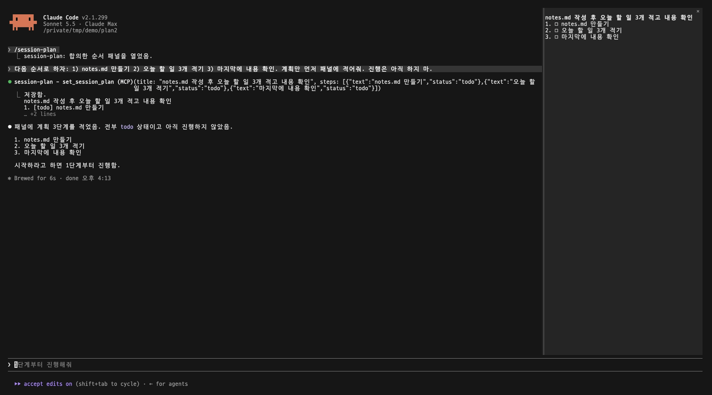
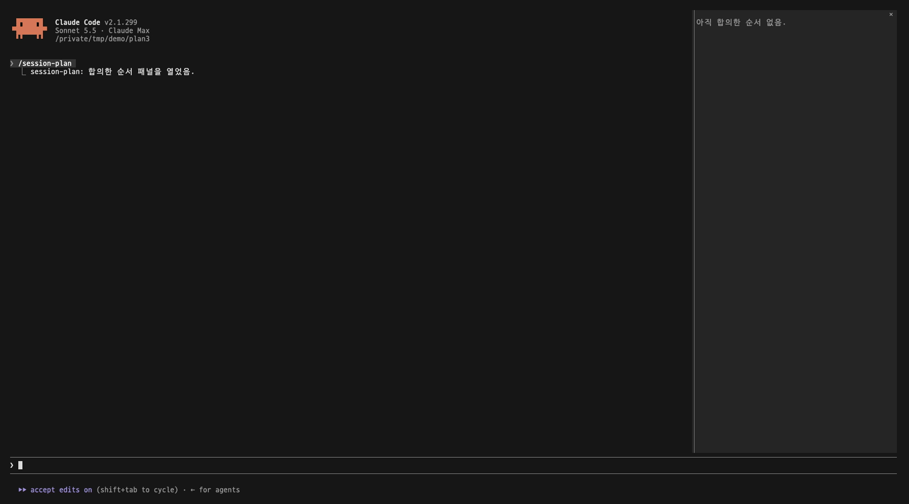
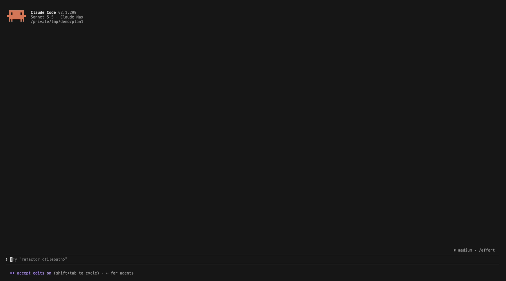
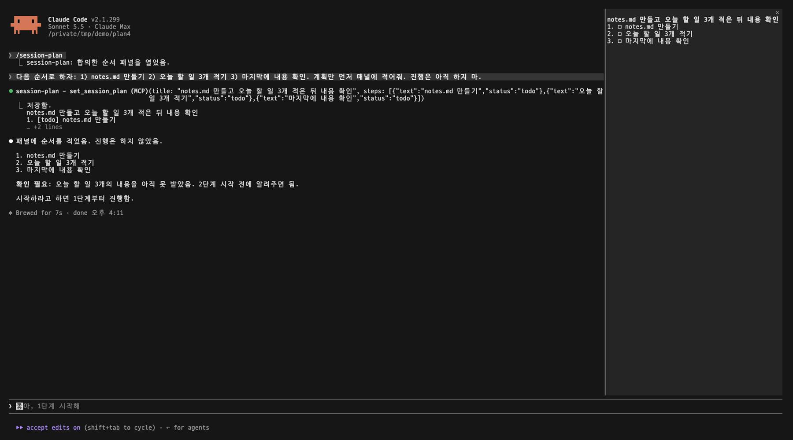

# Session Plan

<p align="center">
  <a href="./README.md"></a>
  <a href="./README.ko.md"></a>
</p>

[Claude Code](https://code.claude.com)와 합의한 작업 순서를 옆 패널에 계속 띄워 두는 플러그인입니다. 어디까지 했는지 단계별로 보입니다.



## 목차

- [만든 이유](#만든-이유)
- [1. 설치](#1-설치)
- [2. 설치 후](#2-설치-후)
- [3. 패널에 보이는 것](#3-패널에-보이는-것)
- [4. 순서가 적히는 방식](#4-순서가-적히는-방식)
- [5. 패널 끄고 켜기](#5-패널-끄고-켜기)
- [참고](#참고)

## 만든 이유

Claude Code와 일할 때는 먼저 순서를 정하는 경우가 많습니다. 이것부터 하고, 그다음 저것, 마지막에 확인. 이 순서는 일하는 내내 확인해야 합니다. 그런데 대화가 길어지면 순서가 위로 밀려 올라가서 확인할 수가 없게 됩니다.

Session Plan은 그 순서를 대화 옆 패널에 두고, 끝난 것과 진행 중인 것과 남은 것을 보여줍니다.

## 1. 설치

Claude Code 입력창에 입력합니다.

```
/plugin install session-plan --marketplace selvr0/session-plan
```

1. `Add marketplace?`가 나오면 `y`를 누릅니다.
2. 범위를 고릅니다. 보통 `user`(모든 프로젝트)를 씁니다.
3. `Installed session-plan. Plugin is now active.`가 나오면 끝입니다.

## 2. 설치 후

패널을 엽니다.

```
/session-plan
```

한 번 열면 다음 세션부터는 알아서 열립니다.

**오른쪽에 붙이려면** Claude Code를 전체 화면 레이아웃으로 써야 합니다. 아니면 입력창 위에 뜹니다.

```
/tui fullscreen
```

**한국어로 보려면** `/config`에서 `session-plan`을 찾아 `language`를 `ko`로 바꿉니다. 기본은 영어입니다.

다른 패널이 열려 있으면 위쪽에 패널마다 탭이 생깁니다. 탭을 눌러 오갑니다.

## 3. 패널에 보이는 것

```
배포 준비
1. ✓ 폴더 이름 바꾸기                      ▸ 3/3
2. ⠹ README 쓰기 (진행 중)
3. □ GitHub에 올리기                       ▸ 0/2
4. □ 알리기
```

| 표시 | 뜻 |
|---|---|
| `□` | 아직 안 함 |
| 도는 표시, 노란색 | 진행 중. 한 번에 한 단계만 |
| `✓`, 흐리게 | 끝남 |

- 단계에는 `1.`, `2.`, 하위 단계에는 `2.1`, `2.2` 순번이 늘 같은 자리에 붙습니다.
- 하위 단계가 있는 단계는 오른쪽에 `▸`와 끝난 개수가 보입니다. 단계를 누르면 하위 단계를 펼치고 접습니다. 진행 중인 단계는 처음부터 펼쳐져 있습니다.



## 4. 순서가 적히는 방식

순서는 손으로 고치지 않습니다. 대화에서 정하면 Claude가 적습니다.

- **시작하기 전**: 할 일이 두 단계 이상이면 Claude가 먼저 순서를 제안하고 묻습니다.
- **적는 때**: 순서를 합의했을 때만 적습니다. 예를 들어 "이 순서로 하자"고 하거나, Claude가 제안한 순서에 좋다고 답했을 때입니다. Claude가 혼자 세운 계획은 적지 않습니다.
- **일하는 동안**: 단계를 시작하면 진행 중으로, 끝내면 끝남으로 바꿉니다.
- **바꿀 때**: 순서를 바꾸자고 하면 바꿉니다. Claude가 바꾸는 게 낫다고 보면 먼저 묻습니다.
- **대화가 요약된 뒤**: Claude가 순서를 다시 읽을 수 있습니다.

순서를 정할 때:



순서를 바꿀 때:



플러그인은 이 규칙을 짧은 단락으로 매 요청 Claude의 시스템 프롬프트에 넣고, `set_session_plan`, `get_session_plan` 두 도구를 줍니다. 단락 글자는 늘 같아서 프롬프트 캐시가 그대로 쓰입니다. 저장하기 전에 도구가 형식을 확인합니다. 단계는 안 함·진행 중·끝남 중 하나여야 하고, 진행 중은 하나만 둘 수 있습니다.

순서는 세션마다 따로, 플러그인 저장소에 둡니다.

## 5. 패널 끄고 켜기

| 하고 싶은 것 | 입력 |
|---|---|
| 패널 끄기 | `/plugin disable session-plan@session-plan` |
| 다시 켜기 | `/plugin enable session-plan@session-plan` |
| 지우기 | `/plugin uninstall session-plan@session-plan` |

그다음 `/reload-plugins`를 치거나 새 세션을 엽니다.

## 참고

- Claude Code mod(함수 훅) 위에서 돕니다. mod는 아직 얼리 액세스라, Claude Code 업데이트 뒤 패널이 고쳐질 때까지 안 될 수 있습니다.

## 개발

```
claude plugin validate .
```

## 라이선스

[MIT](./LICENSE)
