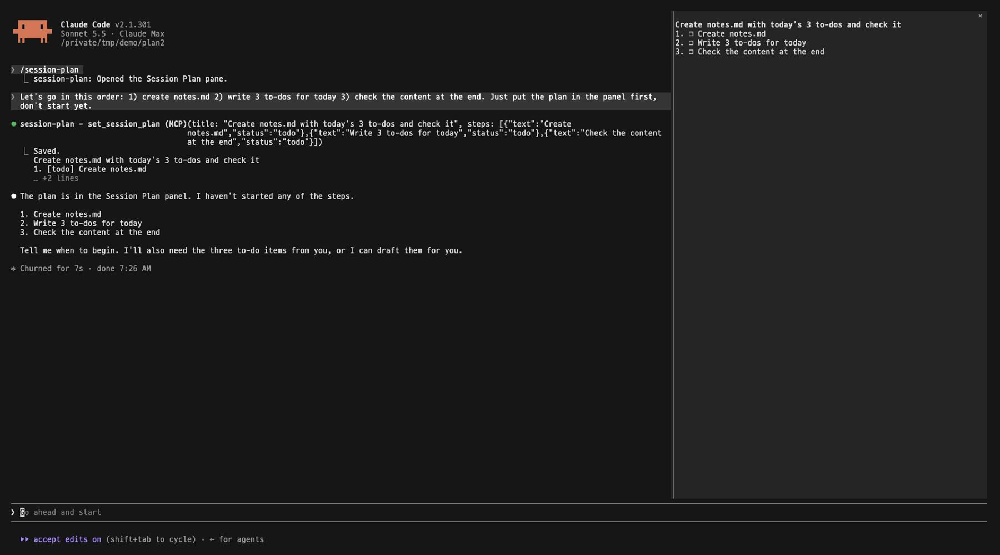
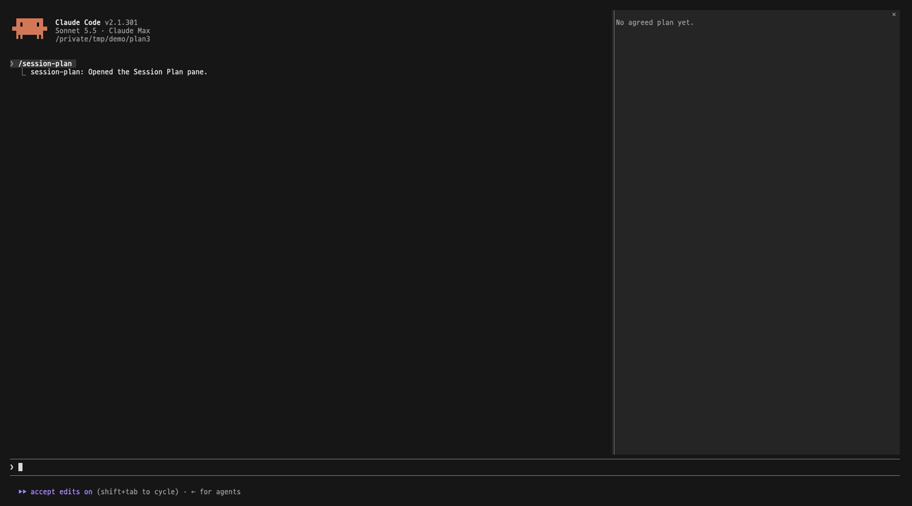
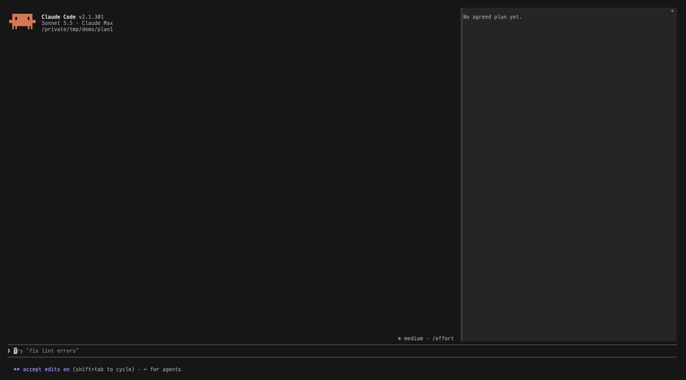
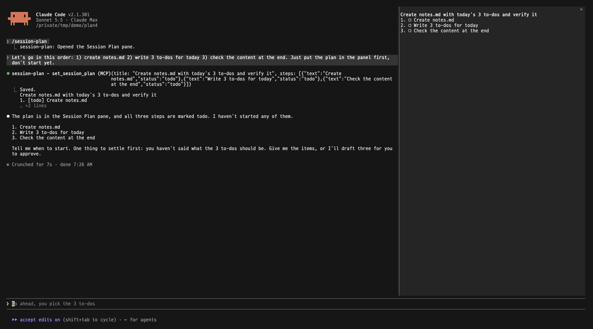

# Session Plan

<p align="center">
  <a href="./README.md"></a>
  <a href="./README.ko.md"></a>
</p>

A side panel for [Claude Code](https://code.claude.com) that keeps the work plan you agreed on with Claude in view, step by step, while you work through it.



## Contents

- [Why we built this](#why-we-built-this)
- [1. Install](#1-install)
- [2. After installing](#2-after-installing)
- [3. What you see in the panel](#3-what-you-see-in-the-panel)
- [4. How the plan gets written](#4-how-the-plan-gets-written)
- [5. Turn the panel off or on](#5-turn-the-panel-off-or-on)
- [Notes](#notes)

## Why we built this

When you work with Claude Code, you often agree on an order first: do this, then that, then check this. You need to keep checking that plan as you go. But as the conversation grows, the plan scrolls up and out of sight, and you can no longer check it.

Session Plan keeps that plan in a panel beside the conversation, with what is done, what is in progress and what is left.

## 1. Install

Type this at the Claude Code prompt:

```
/plugin install session-plan --marketplace selvr0/session-plan
```

1. `Add marketplace?` appears. Press `y`.
2. Choose the scope. `user` (all your projects) is the usual choice.
3. `Installed session-plan. Plugin is now active.` appears.

## 2. After installing

Open the panel:

```
/session-plan
```

After you open it once, it opens by itself in every new session.

**To dock it on the right**, Claude Code needs its fullscreen layout. Without it, the panel shows above the prompt instead.

```
/tui fullscreen
```

**To see the panel in Korean**, open `/config`, find `session-plan`, and set `language` to `ko`.

If another panel is open, each one gets a tab at the top. Click a tab to switch.

## 3. What you see in the panel

```
Release checklist
1. ✓ Rename the folders                    ▸ 3/3
2. ⠹ Write the README (in progress)
3. □ Push to GitHub                        ▸ 0/2
4. □ Announce
```

| Mark | Meaning |
|---|---|
| `□` | Not started |
| Spinning mark, yellow | In progress. Only one step at a time |
| `✓`, dimmed | Done |

- Steps are numbered `1.`, `2.`, and sub-steps `2.1`, `2.2`, always in the same column.
- A step with sub-steps shows `▸` and how many are done on the right. Click the step to open or close its sub-steps. The step in progress starts open.



## 4. How the plan gets written

You do not edit the plan by hand. You agree on it in the conversation, and Claude writes it.

- **Before starting**: when the work has two or more steps, Claude proposes an order and asks you first.
- **When Claude writes it**: only when you agree on an order, for example when you say "let's go in this order" or say yes to an order Claude proposed. A plan Claude makes up on its own is not written.
- **While working**: Claude marks a step in progress when it starts it, and done when it finishes.
- **Changes**: when you ask to change the order, Claude changes it. When Claude thinks the order should change, it asks you first.
- **After the conversation is compacted**: Claude can read the plan back.

Agreeing on a plan:



Changing the order:



The plugin adds these rules as a short paragraph to Claude's system prompt on every request, and gives Claude two tools, `set_session_plan` and `get_session_plan`. The paragraph never changes, so the prompt cache keeps working. The tool checks the plan before saving it: each step must be not started, in progress or done, and only one step can be in progress.

Each session keeps its own plan, in the plugin's own storage.

## 5. Turn the panel off or on

| You want to | Type |
|---|---|
| Turn the panel off | `/plugin disable session-plan@session-plan` |
| Turn it back on | `/plugin enable session-plan@session-plan` |
| Remove it | `/plugin uninstall session-plan@session-plan` |

Run `/reload-plugins` afterwards, or start a new session.

## Notes

- Built on Claude Code mods (function hooks), which are in early access. A Claude Code update may break the panel until it is updated.

## Development

```
claude plugin validate .
```

## License

[MIT](./LICENSE)
